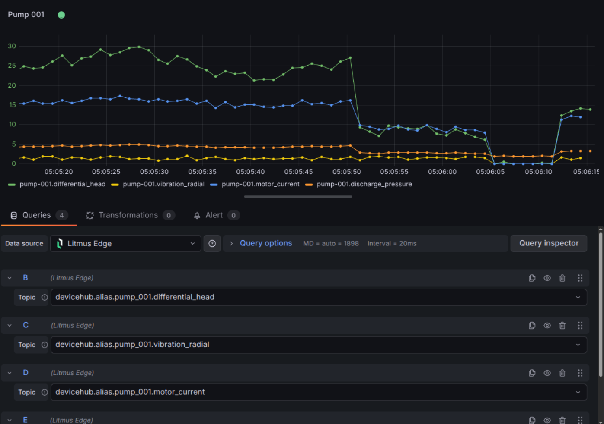

# Litmus Edge data source for Grafana

Stream live operational data from [Litmus Edge](https://litmus.io) directly into Grafana dashboards. The plugin subscribes to NATS topics on the edge and pushes frames into panels in real time — no polling, no historical database required.



## Installation

Pick one path. Option 1 installs the plugin in a Grafana instance you already run. Option 2 starts a new Grafana container with the plugin preinstalled.

### Option 1: Install the plugin in an existing Grafana instance

Requirements: Grafana v12.2 or later, Litmus Edge v3.16 or later, and shell access to the Grafana host or container.

1. Install the plugin from the latest GitHub release:

   ```bash
   grafana cli \
     --pluginUrl https://github.com/litmusautomation/edge-datasource/releases/latest/download/litmus-edge-datasource.zip \
     plugins install litmus-edge-datasource
   ```

   To install without Grafana CLI, download `litmus-edge-datasource.zip` from [GitHub Releases](https://github.com/litmusautomation/edge-datasource/releases) and extract it into the Grafana plugins directory (default `/var/lib/grafana/plugins/`).

2. Restart Grafana.
3. Add the data source in the UI ([instructions](https://grafana.com/docs/grafana/latest/datasources/add-a-data-source/)), or provision it with one of the files below. Set `type` to `litmus-edge-datasource`.
4. Click **Save & test**. The message "Connected to the Edge" confirms the setup.

#### Provisioning: Grafana running inside Litmus Edge

```yaml
apiVersion: 1

datasources:
  - name: Litmus Edge
    type: litmus-edge-datasource
    access: proxy
    jsonData:
      externalEdge: false
      gatewayIp: ${EDGE_DOCKER_GATEWAY_IP}
    secureJsonData:
      apiToken: ${EDGE_API_TOKEN}
```

#### Provisioning: Grafana connecting to an external Litmus Edge

```yaml
apiVersion: 1

datasources:
  - name: Litmus Edge
    type: litmus-edge-datasource
    access: proxy
    jsonData:
      externalEdge: true
      hostname: ${EDGE_HOSTNAME}
      natsProxyPort: ${EDGE_NATS_PROXY_PORT}
    secureJsonData:
      token: ${EDGE_ACCESS_ACCOUNT_API_KEY}
      apiToken: ${EDGE_API_TOKEN}
```

Place the file in the Grafana provisioning directory (default `/etc/grafana/provisioning/datasources/`) and restart Grafana. Set each `${...}` variable in the Grafana environment. The [Quick start](#quick-start) tables describe each value. `apiToken` is optional and enables topic discovery in the query editor.

#### Plugin signature

The plugin is signed for localhost root URLs. If your Grafana `root_url` is not one of them, Grafana refuses to load the plugin. Fix this in one of two ways:

- Set `root_url` to one of the signed localhost URLs.
- Allow the plugin explicitly with `GF_PLUGINS_ALLOW_LOADING_UNSIGNED_PLUGINS=litmus-edge-datasource`.

### Option 2: Run the prebuilt `litmus-grafana` image

This image is Grafana with the plugin installed and the data source provisioned. Use it for a new, standalone setup:

```bash
docker run -p 3000:3000 \
  litmusedge.azurecr.io/litmus-grafana:latest
```

Open `http://localhost:3000`. See [litmus-grafana/README.md](https://github.com/litmusautomation/edge-datasource/blob/main/litmus-grafana/README.md) for environment variables and external-connection setup.

## Quick start

### Running inside Litmus Edge

Leave **Remote Connection** off. [Add the data source](https://grafana.com/docs/grafana/latest/datasources/add-a-data-source/), select **Litmus Edge**, confirm **Edge Docker Gateway IP** (default `10.30.50.1`), and click **Save & test**.

The plugin does not auto-detect this address. Update it if your Litmus Edge instance uses a different Docker gateway IP.

> Optional but recommended: add an **API Token** to enable topic discovery in the query editor.

| Field                      | Description                                                                                                                                    |
| -------------------------- | ---------------------------------------------------------------------------------------------------------------------------------------------- |
| **Edge Docker Gateway IP** | IP used to reach Litmus Edge from the Grafana container. Default: `10.30.50.1`. Update it if this instance uses a different Docker gateway IP. |
| **API Token**              | Optional, but recommended for topic discovery in the query editor.                                                                             |

### Connecting to an external Litmus Edge

In the data source settings, turn on **Remote Connection** and provide:

| Field                      | Description                                                                                                                       |
| -------------------------- | --------------------------------------------------------------------------------------------------------------------------------- |
| **Litmus Edge Address**    | Hostname or IP address of your Litmus Edge instance. Add `:port` only when Litmus Edge uses a non-default port.                   |
| **NATS Proxy Port**        | Port used for live data streaming. Default: `4222`.                                                                               |
| **Access Account API Key** | API key with [NATS Proxy](https://docs.litmus.io/litmusedge/product-features/system/access-control/tokens#nats-proxy) read access |
| **API Token**              | Optional, but recommended for topic discovery in the query editor.                                                                |

The datasource uses the Litmus Edge address for connectivity and the NATS Proxy port for live streaming.

Click **Save & test** — you should see "Connected to the Edge".

## Usage

Add a panel, select the Litmus Edge data source, and enter a NATS topic:

```
devicehub.alias.demo.bearing_temperature
```

The plugin subscribes and streams frames once per second. Each query row maps to one topic — add multiple rows to monitor several data points on the same panel.

**Template variables** are supported in the topic field (`$site.$area.$line.$sensor`) and resolve before each query, making it easy to build reusable dashboards across sites or production lines.

### Data types

| Payload                    | Grafana type                                   |
| -------------------------- | ---------------------------------------------- |
| Number                     | Float64                                        |
| String                     | String                                         |
| Boolean                    | Boolean                                        |
| Null                       | Nullable                                       |
| JSON array / nested object | JSON (use the "Extract Fields" transformation) |

Every frame includes a `Time` field derived from the payload's `timestamp`. The plugin accepts Unix timestamps in milliseconds or seconds, and falls back to arrival time when the timestamp is absent or not epoch-based. DeviceHub messages also carry metadata labels: `tagName`, `deviceName`, `deviceId`, `datatype`, `description`, and `registerId`.

### Customizing legends

Use label variables in **Field > Standard options > Display name** to build meaningful series names:

```
${__field.labels.deviceName}.${__field.labels.tagName}
```

## Known limitations

- **Live data only** — no historical queries. Pair with a time-series database for historical analysis.
- **No wildcard topics** — NATS wildcards (`*`, `>`) are not supported.
- **One topic per query row** — add multiple rows for multiple topics.
- **1-second resolution** — incoming messages are batched and pushed once per second.
- **10 000-message buffer** — messages beyond the buffer cap are dropped (logged as a warning).

## Troubleshooting

| Problem                           | What to check                                                                                                                           |
| --------------------------------- | --------------------------------------------------------------------------------------------------------------------------------------- |
| **Save & test fails** (inside LE) | Is **Edge Docker Gateway IP** correct for this Litmus Edge instance? Can the container reach Litmus Edge on port `4222`?                |
| **Save & test fails** (external)  | Is Litmus Edge reachable on the configured NATS Proxy port? Is the NATS Proxy enabled? Is the Access Account API Key valid?             |
| **No data**                       | The topic must be an exact NATS subject — no wildcards. Verify the device is publishing and check Grafana logs for `"Topic not found"`. |
| **Stale data after reconnect**    | NATS may buffer messages while disconnected. Refresh the dashboard to clear stale frames.                                               |
| **"Messages dropped"**            | The topic exceeds the 10 000-message buffer. Subscribe to a more specific subject.                                                      |

### Rotating credentials

Tokens are stored in Grafana's [secure JSON data](https://grafana.com/docs/grafana/latest/administration/provisioning/#datasources) and are never exposed to the browser after initial setup. To rotate, edit the data source, enter the new token, and click **Save & test**.

## Contributing

See [CONTRIBUTING.md](https://github.com/litmusautomation/edge-datasource/blob/main/CONTRIBUTING.md).

## License

Copyright 2026 Litmus Automation, Inc.

Licensed under the [Apache License, Version 2.0](https://github.com/litmusautomation/edge-datasource/blob/main/LICENSE).
